# Семейный сервер: руководство для всей семьи

_Версия от 18.10.2026. Для Юлии, Виталика, Саши и всех, кому Алекс откроет доступ._

Этот портал — наш домашний «мини-интернет»: кино, фото, файлы, чат со звонками, помощница Оливия. Всё лежит на компьютере дома, ничего не уходит в чужие облака.

> **Про картинки в руководстве.** Они сняты на отдельном **тестовом** сервере с выдуманными людьми, фильмами, фото и сообщениями (настоящих писем, паролей и ключей на них нет). Экран «Состояние» (пункт 9) показывает настоящие показания домашнего компьютера, имя компьютера закрашено. Если в руководстве написано «пока не работает» — так и есть, список в конце.

## Содержание

1. [Как открыть портал](#1-как-открыть-портал)
2. [Первый вход и пароль](#2-первый-вход-и-пароль)
3. [Главная](#3-главная)
4. [Кинотеатр](#4-кинотеатр)
5. [Фото и файлы](#5-фото-и-файлы)
6. [Чат и звонки](#6-чат-и-звонки)
7. [Оливия](#7-оливия)
8. [Загрузки](#8-загрузки)
9. [Состояние сервера и администрирование (для Алекса)](#9-состояние-сервера-и-администрирование-для-алекса)
10. [Если что-то не работает](#10-если-что-то-не-работает)
11. [Что пока не работает или не проверено](#11-что-пока-не-работает-или-не-проверено)
12. [Как обновить картинки в руководстве](#12-как-обновить-картинки-в-руководстве)

## 1. Как открыть портал

Основной адрес: **https://server-home.tail89d77e.ts.net**. Он открывается из любого места — дома, в дороге, в другой стране, — когда на телефоне или компьютере включено приложение **Tailscale** и выполнен вход в семейную сеть. Без Tailscale адрес не открывается: так задумано, это защита.

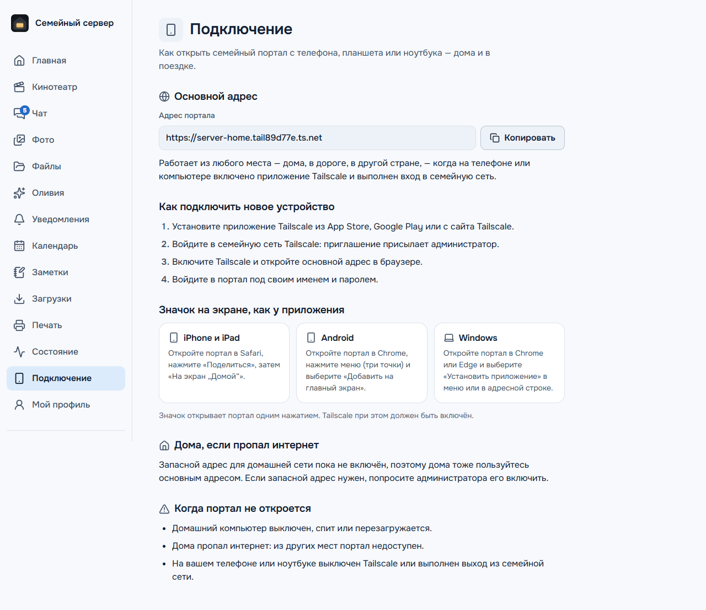

Как подключить новое устройство:

1. Установите приложение Tailscale (App Store, Google Play или сайт Tailscale).
2. Войдите в семейную сеть — приглашение присылает Алекс.
3. Включите Tailscale и откройте адрес в браузере.
4. Добавьте портал на экран, чтобы он открывался как приложение: на iPhone — Safari → «Поделиться» → «На экран „Домой“»; на Android — Chrome → меню → «Добавить на главный экран»; на компьютере — «Установить приложение».

Портал работает, пока домашний компьютер включён и дома есть интернет. Если он не открывается, смотрите [раздел 10](#10-если-что-то-не-работает).

## 2. Первый вход и пароль

Алекс создаёт вам учётную запись и сообщает **временный пароль** (лично, не перепиской). Он действует 7 дней и только для первого входа: портал сразу попросит придумать свой пароль — не короче 10 символов. Удобно взять три-четыре своих слова через дефис и пару цифр.

Раздел **«Мой профиль»** — ваши настройки:

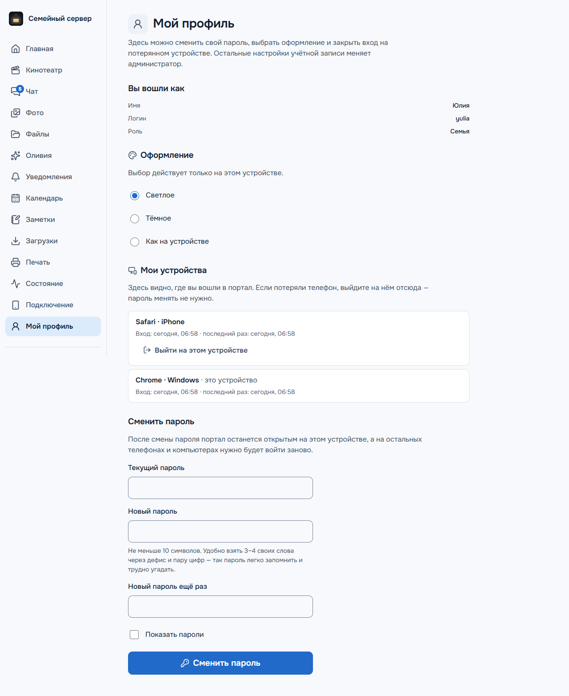

- **Оформление**: светлое, тёмное или как на устройстве (действует только на этом устройстве).
- **Мои устройства**: где вы вошли. **Потеряли телефон?** Нажмите «Выйти на этом устройстве» напротив него — пароль менять не нужно. Если телефон уже у чужого человека, скажите Алексу: он может отключить вход совсем.
- **Сменить пароль**: после смены портал останется открытым на этом устройстве, а на остальных придётся войти заново.

## 3. Главная

На главной — состояние кинотеатра, недавно добавленное, события календаря на сегодня и завтра, важные сообщения сервера. Если что-то сломалось, здесь появится понятная плашка с советом.

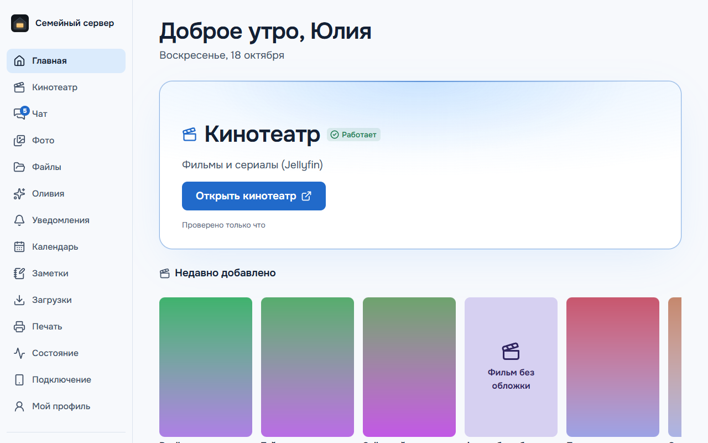

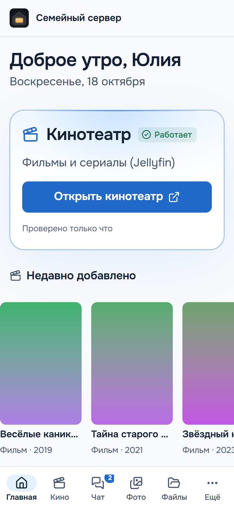

На телефоне меню внизу: «Главная», «Кино», «Чат», «Фото», «Файлы» и «Ещё» (остальное).

## 4. Кинотеатр

В «Кинотеатре» — фильмы, сериалы, мультфильмы, музыка и аудиокниги семьи: афиши, описание, жанры, поиск, «Продолжить просмотр» (место остановки у каждого своё).

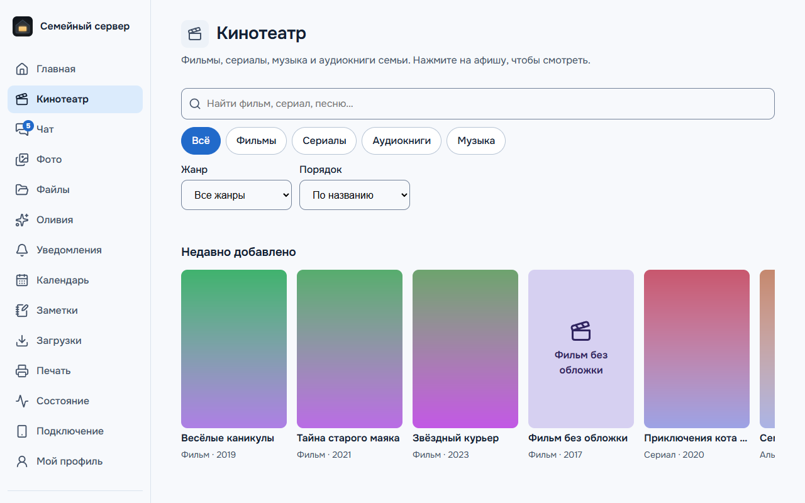

Нажмите на афишу — откроется карточка. «Смотреть» запускает фильм прямо в браузере; «Открыть в Jellyfin» — сам плеер Jellyfin (его же можно поставить на телевизор).

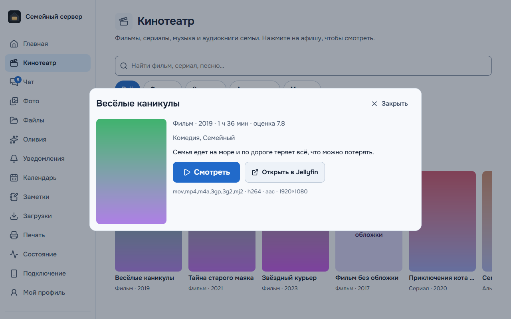

На телефоне то же самое:

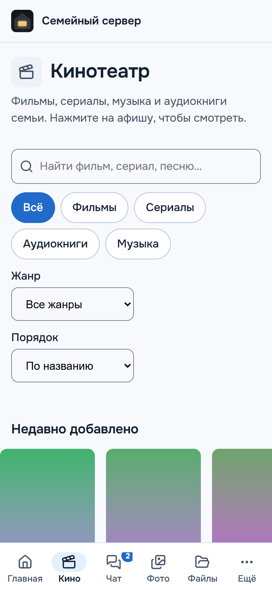

Важно знать:

- Тяжёлые форматы (MKV, HEVC, 4K) браузер может не потянуть: тогда помогает Jellyfin, он перекодирует видео.
- Если Jellyfin временно недоступен, внизу «Кинотеатра» есть **«Запасной просмотр без Jellyfin»**: простые файлы (mp4, webm, mp3 и т. п.) играют прямо из портала.

## 5. Фото и файлы

**Фото.** «Добавить фото и видео» — выберите снимки на телефоне или компьютере. Они раскладываются по месяцам. Это не автокопирование: фото добавляются вручную. Раздел «Мои» видите только вы, «Общие» — вся семья.

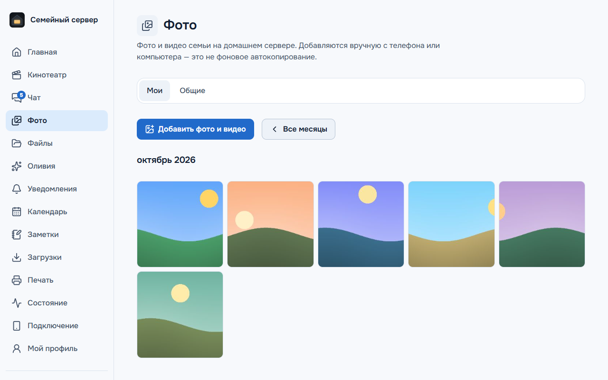

**Файлы.** «Личное» видите только вы (даже администратор через портал не видит), «Общее» — вся семья. Можно загружать, открывать, скачивать, переименовывать, создавать папки. «В корзину» ничего не стирает навсегда: удалённое лежит в корзине сервера, Алекс может вернуть. Программы (.exe, .bat и т. п.) не принимаются — это защита.

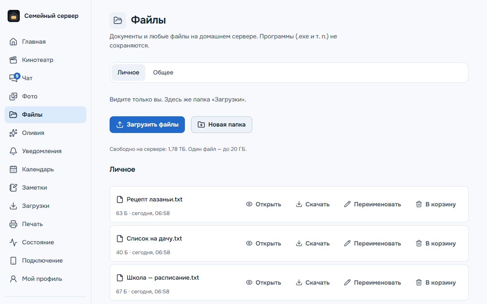

Копии: сервер каждую ночь копирует файлы и фото на запасной носитель. Копии вне дома пока нет ([раздел 11](#11-что-пока-не-работает-или-не-проверено)).

## 6. Чат и звонки

В «Чате» — разговоры один на один и группы («Вся семья» есть всегда; можно создать свою, например «Дача»). К сообщению можно прикрепить фото или файл (скрепка). Под своим сообщением видно «Доставлено» и «Прочитали».

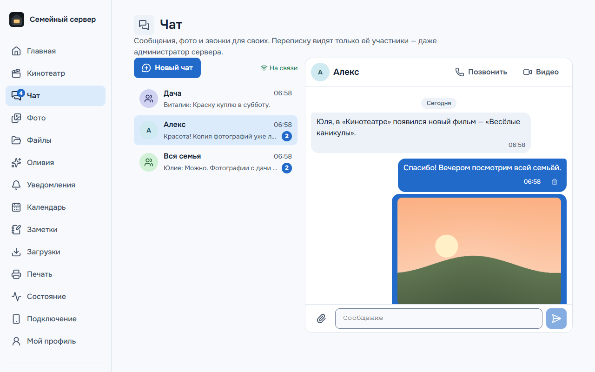

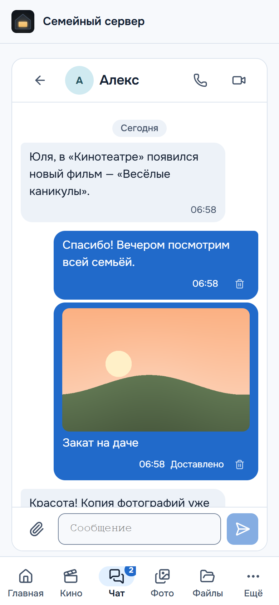

**Переписку видят только её участники — даже администратор сервера.** Файлы чата лежат на домашнем компьютере, как и всё остальное.

**Звонки.** В разговоре есть кнопки «Позвонить» (голос) и «Видео». Во время звонка можно выключить звук и камеру. В звонке — до 4 человек.

Входящий звонок выглядит так:

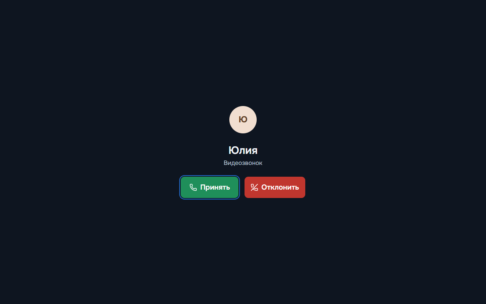

А так — идущий разговор (на снимке тестовая «камера»):

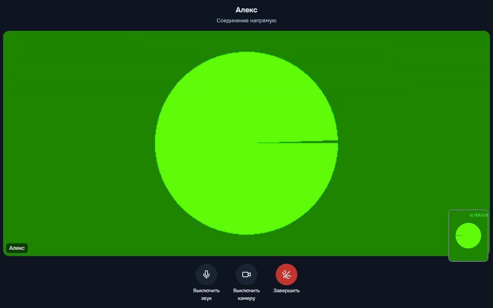

Что нужно знать о звонках честно:

- Камера и микрофон работают только при открытии портала по основному адресу (Tailscale) — браузеры не разрешают их на обычных `http://`-адресах.
- Если портал закрыт, звонок вы не услышите — придёт только уведомление (если включено). На iPhone входящий звонок виден, только когда портал открыт.
- Звонок между двумя устройствами **в разных сетях** проверен пока только на одном компьютере двумя окнами; Алексу нужно проверить его на настоящих устройствах ([runbooks/chat-and-calls.md](runbooks/chat-and-calls.md)). Через мобильную сеть без Tailscale он может не соединиться.

**Уведомления.** Раздел «Уведомления» показывает, что случилось, пока вас не было, и позволяет выбрать, о чём сообщать (сообщения, звонки, завершённые загрузки, проблемы сервера). Кнопка «Включить уведомления» включает их на этом устройстве.

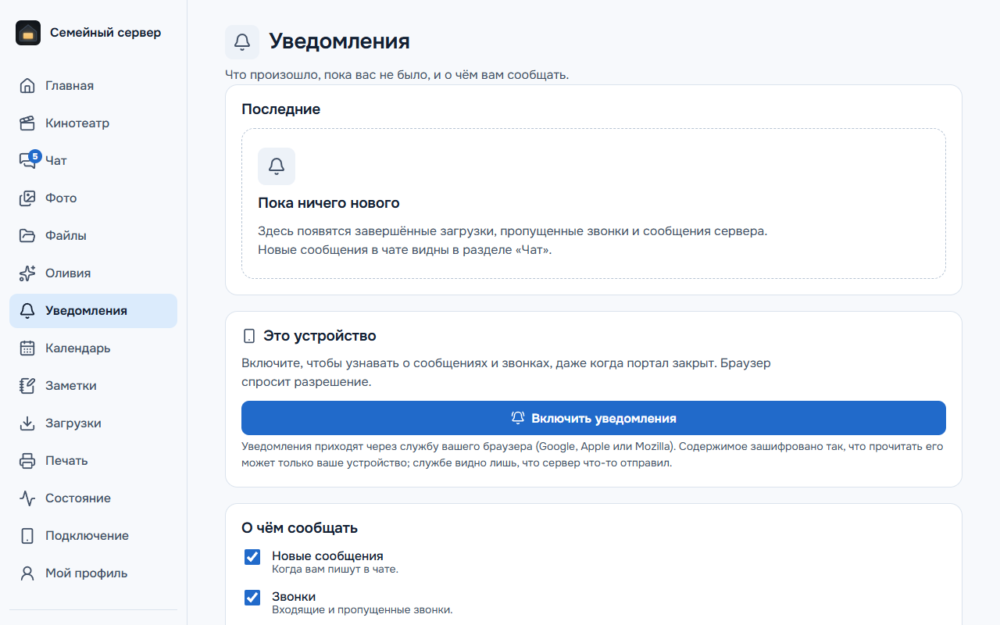

На iPhone уведомления работают только если портал добавлен «На экран „Домой“» (iOS 16.4 и новее). Одинаково на всех устройствах они не работают — это ограничения самих телефонов.

## 7. Оливия

Оливия — помощница сервера. Спросите её простыми словами: «найди фильм про каникулы», «сколько места на диске», «что с моими загрузками», «что у нас сегодня в календаре», «как установить портал на телефон».

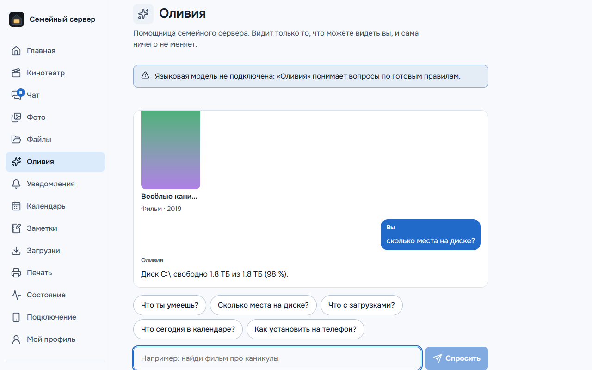

- Она видит только то, что можете видеть вы.
- Сама ничего не удаляет и не скачивает: для ссылки она лишь проверяет её и показывает кнопку «Скачать» — решаете вы.
- Работает только на домашнем компьютере: ни в какие облачные ИИ не обращается.
- Над строкой вопроса написано, подключена ли языковая модель. Сейчас на снимке сказано «Языковая модель не подключена»: Оливия понимает **готовые формулировки**. С моделью она поймёт свободнее; модель ещё не установлена ([раздел 11](#11-что-пока-не-работает-или-не-проверено)).

## 8. Загрузки

Раздел для тех, у кого есть право «Загрузки» (его выдаёт Алекс). Можно скачать файл по ссылке, по магнитной ссылке или из файла `.torrent` — **только то, что вам разрешено законом и правообладателем**. Программы и скрипты не сохраняются.

Перед стартом портал показывает, что внутри и сколько места нужно, и спрашивает, куда сохранить: в свои файлы или в общую медиатеку (фильмы, сериалы, мультфильмы, музыка):

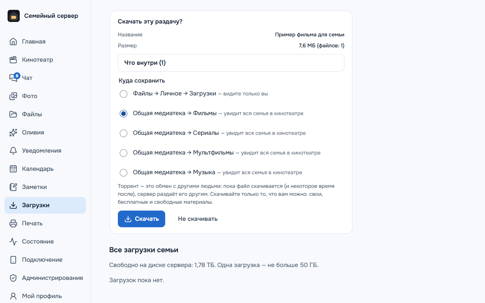

Очередь показывает прогресс, скорость, оставшееся время и ошибки; есть «Пауза» и «Отменить». Когда готово, фильм из медиатеки открывается кнопкой «Открыть в кинотеатре».

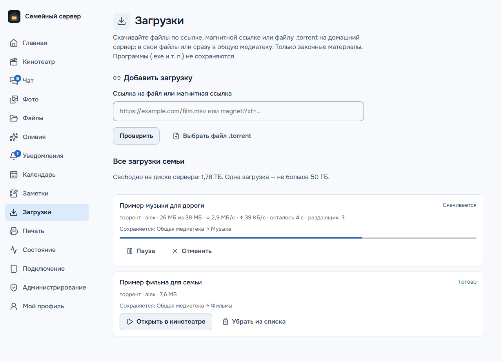

Торрент — это обмен с другими: пока файл скачивается (и недолго после), сервер отдаёт его другим. Отдача ограничена, чтобы не забить домашний интернет. **Торрент-клиент ещё не установлен на сервере** ([раздел 11](#11-что-пока-не-работает-или-не-проверено)): на снимке очередь работает на проверочном макете клиента, а прямые ссылки работают уже сейчас.

## 9. Состояние сервера и администрирование (для Алекса)

**«Состояние»** — как себя чувствует домашний компьютер: процессор по ядрам, память, видеокарта, сеть, диски (что они сообщают о себе), удалённый доступ, принтер, резервные копии, программы сервера и график за сутки. Что не измерено, так и написано — «Недоступно», а не ноль. Серьёзные неполадки приходят уведомлением администратору.

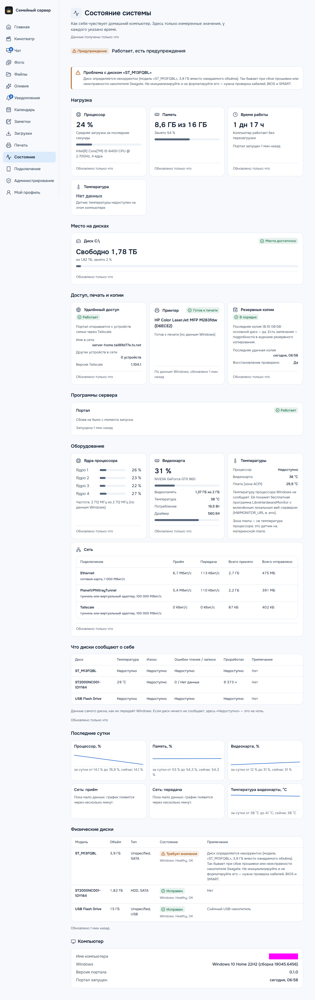

Чего здесь нет честно: температуры процессора. Windows её не сообщает; нужна бесплатная программа LibreHardwareMonitor (шаги — пункт 22 в [owner-actions.md](owner-actions.md)). «Температура платы» — это не процессор.

**«Администрирование»** — люди и журнал:

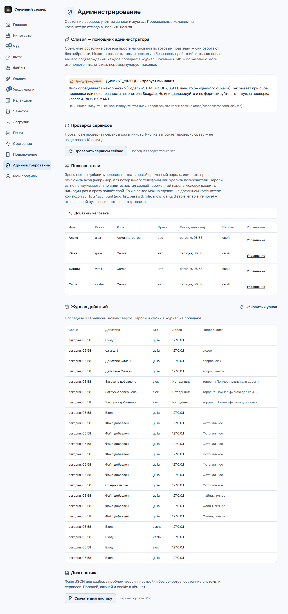

- **Добавить человека**: логин, имя, права. Портал создаёт временный пароль и показывает его **один раз**; передайте лично.
- **Управление**: новый временный пароль, права на загрузки и печать, роль администратора, **отключить вход** (потерянный телефон, ушедший гость) и вернуть, **закрыть вход на устройстве**, удалить человека. Личные файлы удалённого человека не стираются, а убираются в отдельную папку, чтобы их мог вернуть администратор на сервере.
- Администратор **не видит** чужие пароли и чужие личные чаты.
- **Журнал действий** показывает, кто и когда входил и что делал; паролей и ключей в нём нет.
- Через внешний HTTPS-адрес (если Алекс его включит, [runbooks/public-https.md](runbooks/public-https.md)) администрирование недоступно вообще: только через Tailscale.

## 10. Если что-то не работает

| Что случилось | Что делать |
|---|---|
| Портал не открывается | Включён ли Tailscale? Включён ли домашний компьютер, есть ли дома интернет? Откройте на телефоне Tailscale и проверьте, что вход выполнен. Скажите Алексу |
| «Нет связи с домашним сервером» | Сервер не отвечает. Подождите минуту, обновите страницу. Если не проходит — Алексу |
| Фильм не играет | Попробуйте «Открыть в Jellyfin» или «Запасной просмотр» внизу «Кинотеатра». Большие файлы MKV/HEVC иногда не играют в браузере |
| Звонок не соединяется | Включите Tailscale на обоих устройствах; разрешите камеру и микрофон; откройте портал по основному адресу |
| Нет уведомлений на iPhone | Добавьте портал «На экран „Домой“», откройте его оттуда, на странице «Уведомления» нажмите «Включить» |
| Забыли пароль | Скажите Алексу: он выдаст новый временный пароль |
| Потерян телефон | «Мой профиль» → «Мои устройства» → «Выйти» на потерянном; Алексу — отключить вход, если нужно |
| «Это действие недоступно через внешний адрес» | Откройте портал через Tailscale |

## 11. Что пока не работает или не проверено

Здесь честный список. Пока написано «не готово» — полагаться на это нельзя.

| Возможность | Статус |
|---|---|
| Основной портал, кино, файлы, фото, чат, уведомления в портале, Оливия на правилах, Состояние, Администрирование | работает, проверено автоматически; ручные проверки владельца — [owner-actions.md](owner-actions.md) |
| Торренты | код готов; **клиент не установлен** (нужно согласие Алекса на загрузку), настоящая раздача не скачивалась |
| Языковая модель Оливии | код готов; **модель не установлена**, скорость на этом компьютере не измерена |
| Звонки между разными сетями | проверено на двух окнах одного ПК; **на двух настоящих устройствах — нет**; TURN не настроен |
| Уведомления на телефоне (push) | шифрование проверено по тестовому образцу; **на настоящем телефоне не проверено** |
| Дополнительный адрес через интернет (туннель) | **не создан**: нужны аккаунт и домен Алекса; политика безопасности готова |
| Температура процессора | нужна дополнительная программа |
| Копия вне дома | **не настроена**; копии лежат на сервере и на флешке |
| Приложения из App Store и Google Play | не планируются: портал ставится на экран как приложение (PWA) |

## 12. Как обновить картинки в руководстве

Для Алекса. Картинки лежат в `docs/images/family-guide/` и снимаются автоматически на тестовом сервере с выдуманными данными.

```bash
npm.cmd run build
npm.cmd run guide:screenshots
```

Сценарий — `tests/guide/screenshots.spec.ts`: он сам поднимает тестовый сервер, создаёт Юлию, Виталика, Сашу, сообщения, фото и фильмы, делает снимки и всё удаляет. Экран «Состояние» снимается с настоящими показаниями этого компьютера (имя компьютера закрашивается). Настоящая переписка, пароли и ключи в снимки не попадают. После съёмки откройте несколько картинок глазами и убедитесь, что на них нет ничего личного; тест `server/test/guide-docs.test.ts` проверяет, что все картинки из руководства существуют и это настоящие PNG.
