# Семейный сервер: руководство для всей семьи

_Версия от 20.10.2026. Для всей семьи и всех, кому администратор откроет доступ._

Этот портал — наш домашний «мини-интернет»: кино, фото, файлы, дела, чат со звонками, общий поиск, помощница Оливия. Всё лежит на компьютере дома, ничего не уходит в чужие облака.

> **Про картинки в руководстве.** Они сняты на отдельном **тестовом** сервере с выдуманными людьми, фильмами, фото и сообщениями (настоящих писем, паролей и ключей на них нет). Экран «Состояние» (раздел 11) показывает настоящие показания домашнего компьютера, имя компьютера закрашено. Если в руководстве написано «пока не работает» — так и есть, список в конце.

## Содержание

1. [Как открыть портал](#1-как-открыть-портал)
2. [Первый вход и пароль](#2-первый-вход-и-пароль)
3. [Главная и общий поиск](#3-главная-и-общий-поиск)
4. [Кинотеатр](#4-кинотеатр)
5. [Фото](#5-фото)
6. [Файлы и корзина](#6-файлы-и-корзина)
7. [Дела и списки покупок](#7-дела-и-списки-покупок)
8. [Чат и звонки](#8-чат-и-звонки)
9. [Оливия](#9-оливия)
10. [Загрузки](#10-загрузки)
11. [Состояние сервера и администрирование (для администратора)](#11-состояние-сервера-и-администрирование-для-администратора)
12. [Если что-то не работает](#12-если-что-то-не-работает)
13. [Что пока не работает или не проверено](#13-что-пока-не-работает-или-не-проверено)
14. [Как обновить картинки в руководстве](#14-как-обновить-картинки-в-руководстве)
## 1. Как открыть портал

Основной адрес: **https://server-home.example.ts.net**. Он открывается из любого места — дома, в дороге, в другой стране, — когда на телефоне или компьютере включено приложение **Tailscale** и выполнен вход в семейную сеть. Без Tailscale адрес не открывается: так задумано, это защита.

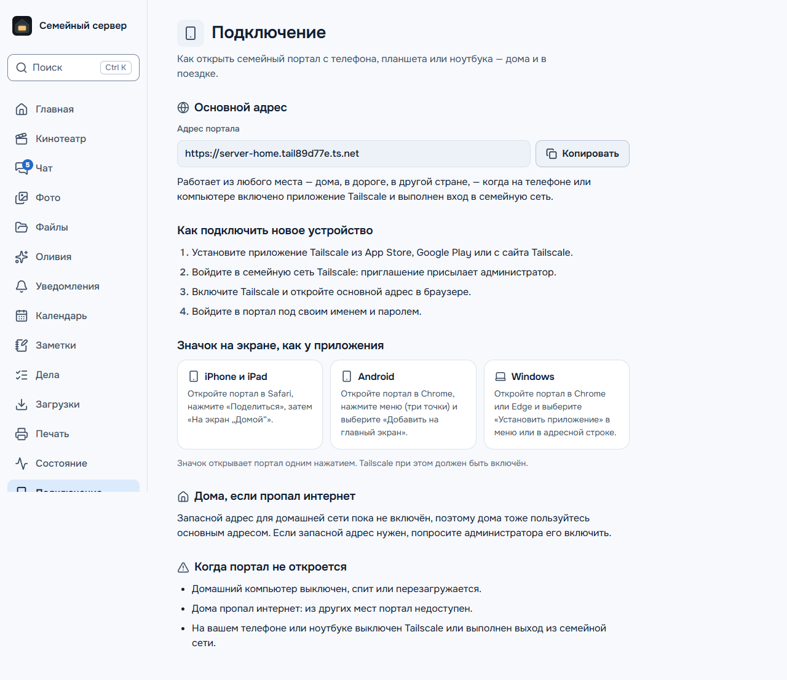

Как подключить новое устройство:

1. Установите приложение Tailscale (App Store, Google Play или сайт Tailscale).
2. Войдите в семейную сеть — приглашение присылает администратор.
3. Включите Tailscale и откройте адрес в браузере.
4. Добавьте портал на экран, чтобы он открывался как приложение: на iPhone — Safari → «Поделиться» → «На экран „Домой“»; на Android — Chrome → меню → «Добавить на главный экран»; на компьютере — «Установить приложение».

Портал работает, пока домашний компьютер включён и дома есть интернет. Если он не открывается, смотрите [раздел 12](#12-если-что-то-не-работает).

## 2. Первый вход и пароль

Администратор создаёт вам учётную запись и сообщает **временный пароль** (лично, не перепиской). Он действует 7 дней и только для первого входа: портал сразу попросит придумать свой пароль — не короче 10 символов. Удобно взять три-четыре своих слова через дефис и пару цифр.

Раздел **«Мой профиль»** — ваши настройки:

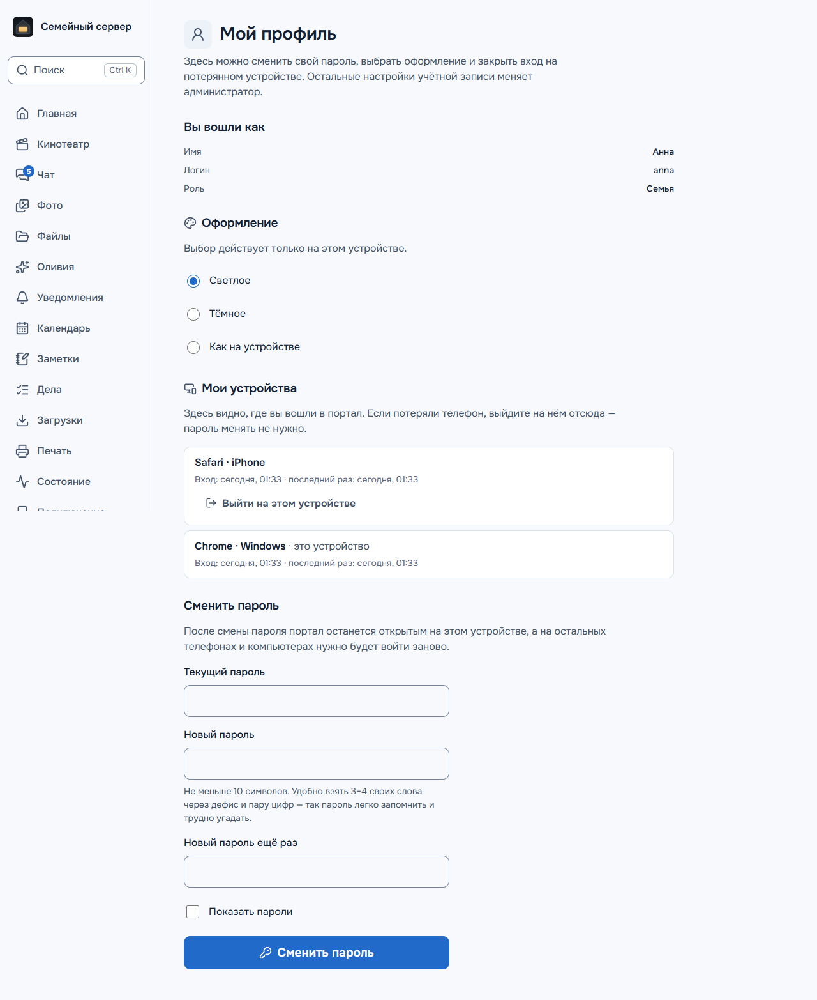

- **Оформление**: светлое, тёмное или как на устройстве (действует только на этом устройстве).
- **Мои устройства**: где вы вошли. **Потеряли телефон?** Нажмите «Выйти на этом устройстве» напротив него — пароль менять не нужно. Если телефон уже у чужого человека, скажите администратору: он может отключить вход совсем.
- **Сменить пароль**: после смены портал останется открытым на этом устройстве, а на остальных придётся войти заново.

## 3. Главная и общий поиск

На главной — состояние кинотеатра, недавно добавленное, события календаря и ваши дела на сегодня, важные сообщения сервера. Если что-то сломалось, здесь появится понятная плашка с советом.

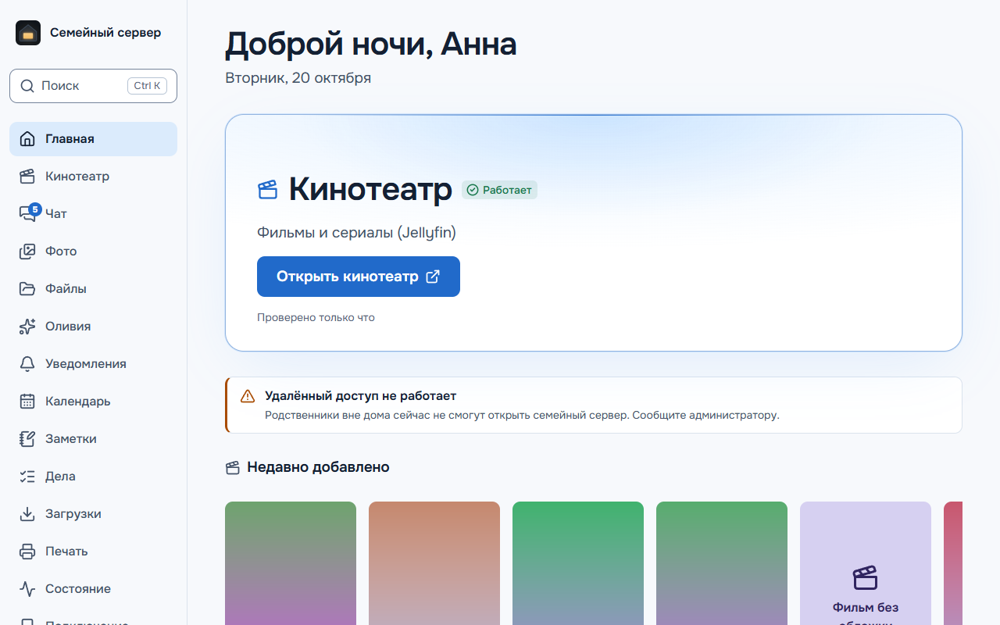

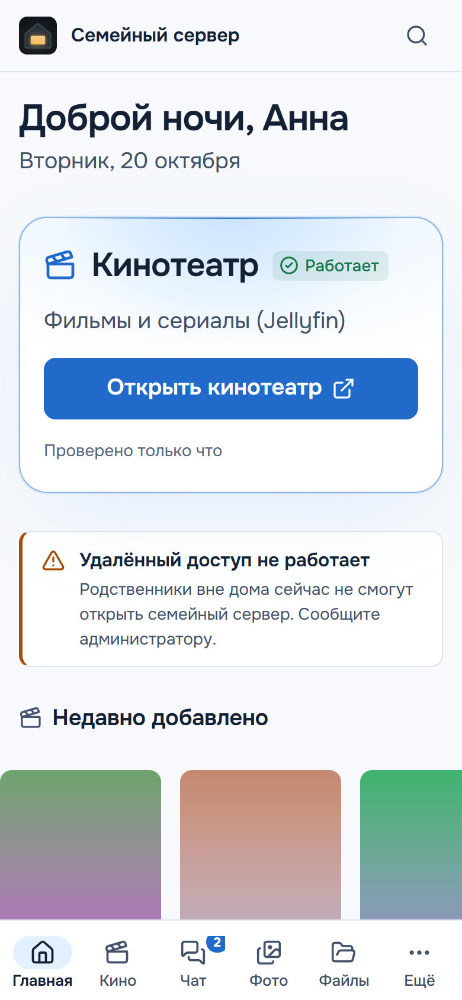

На телефоне меню внизу: «Главная», «Кино», «Чат», «Фото», «Файлы» и «Ещё» (остальное).

**Общий поиск.** Кнопка «Поиск» вверху (на компьютере — Ctrl+K) ищет сразу везде, где вам можно смотреть: фильмы, фото, файлы, заметки, события календаря, дела и ваши переписки. Результаты разложены по группам; кнопки-«фильтры» оставляют только одну группу. Enter открывает первое найденное. Чужое личное в поиске не появляется: личные файлы, личные заметки, чужие чаты и чужие дела он не видит. Если какая-то группа не ответила (например, Jellyfin выключен), поиск так и пишет — остальные группы всё равно показаны.

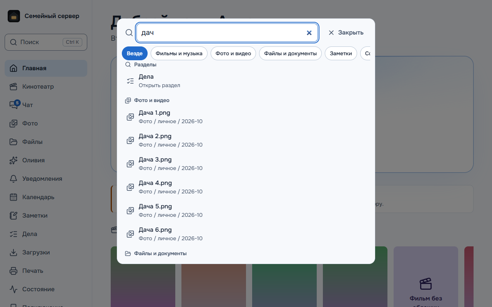
## 4. Кинотеатр

В «Кинотеатре» — фильмы, сериалы, мультфильмы, музыка и аудиокниги семьи: афиши, описание, жанры, поиск, «Продолжить просмотр» (место остановки у каждого своё).

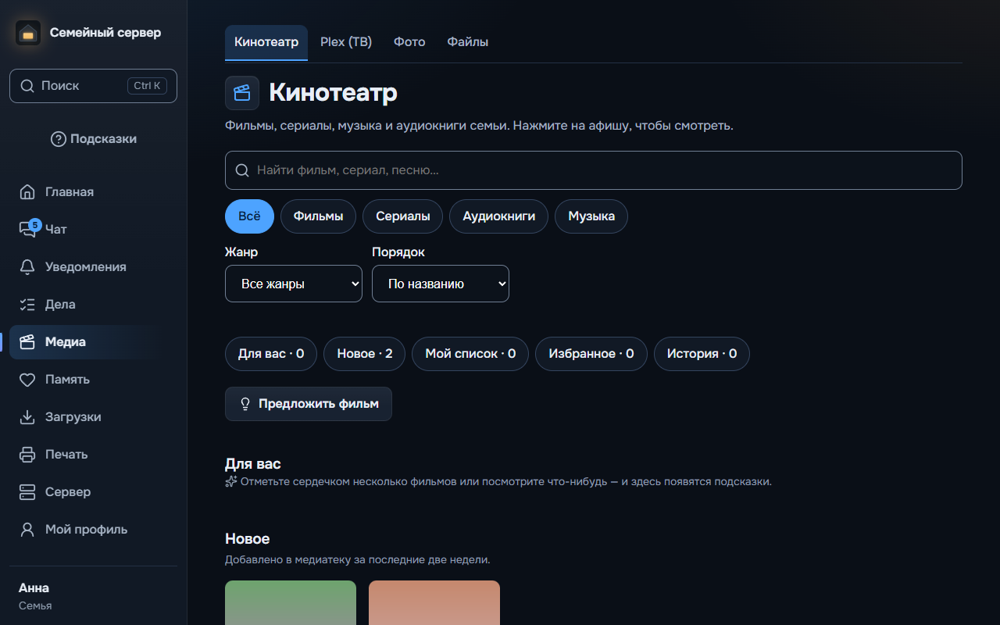

**Свои подборки.** На афише два значка: «Избранное» (сердечко) и «Посмотреть позже» (закладка); в карточке есть и «Просмотрено». Из них собираются **ваши** строки: «Избранное», «Посмотреть позже», «История» (видите только вы). Над ними — «Для вас» (подбор по тому, что вам нравилось, с объяснением «почему») и «Новое» (что добавили за последние две недели). Кнопки-«подборки» открывают строку на всю страницу, где работают поиск и фильтры. Кнопка «Предложить фильм» — короткая форма: что хочется видеть в медиатеке. Предложения видит вся семья, а администратор отвечает на них («добавлено» или «отклонено»).

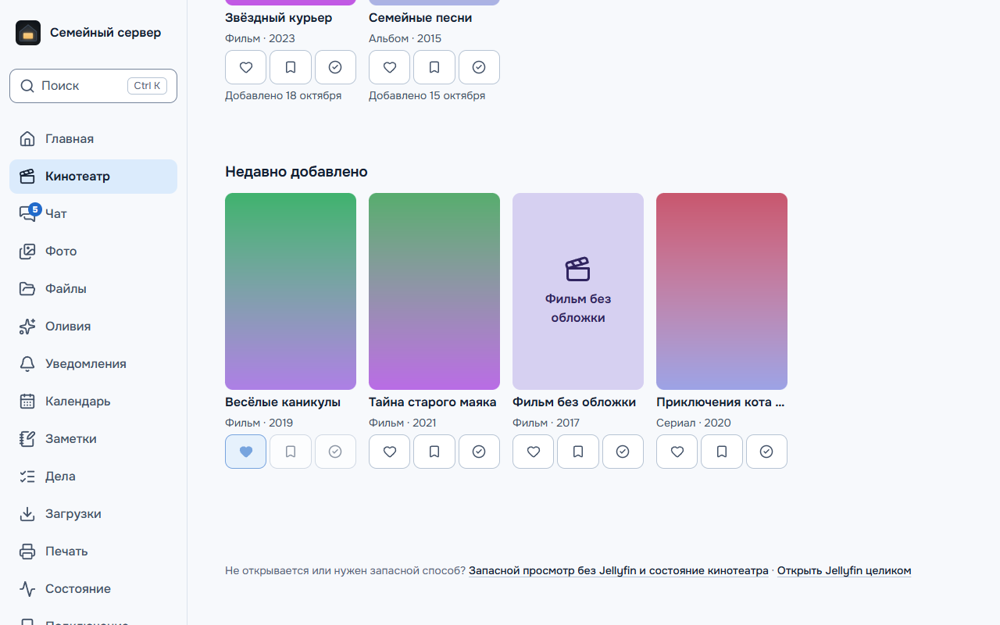

Нажмите на афишу — откроется карточка. «Смотреть» запускает фильм прямо в браузере; «Открыть в Jellyfin» — сам плеер Jellyfin (его же можно поставить на телевизор).

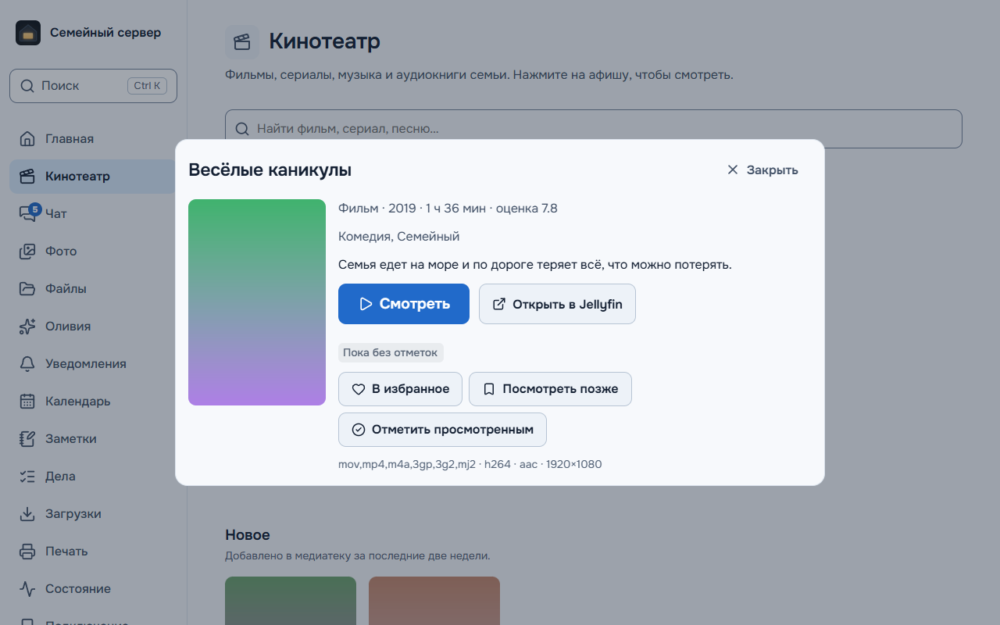

На телефоне то же самое:

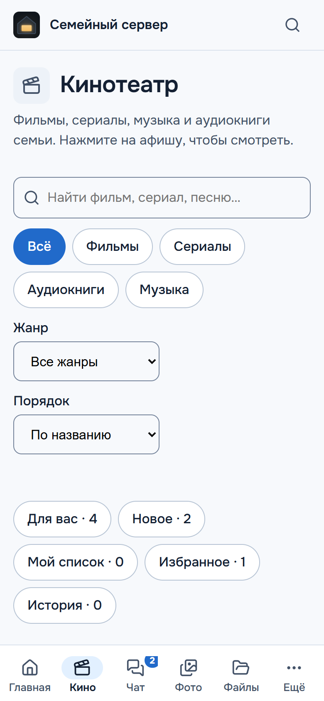

Важно знать:

- Тяжёлые форматы (MKV, HEVC, 4K) браузер может не потянуть: тогда помогает Jellyfin, он перекодирует видео.
- Если Jellyfin временно недоступен, внизу «Кинотеатра» есть **«Запасной просмотр без Jellyfin»**: простые файлы (mp4, webm, mp3 и т. п.) играют прямо из портала.

## 5. Фото

«Добавить фото и видео» — выберите **сразу много** снимков из галереи телефона или с компьютера. Они встают в **одну очередь** с общим процентом, одним предложением о том, что готово, и кнопками «Остановить» и «Повторить». Это не автокопирование: фото добавляются вручную. Раздел «Мои» видите только вы, «Общие» — вся семья.

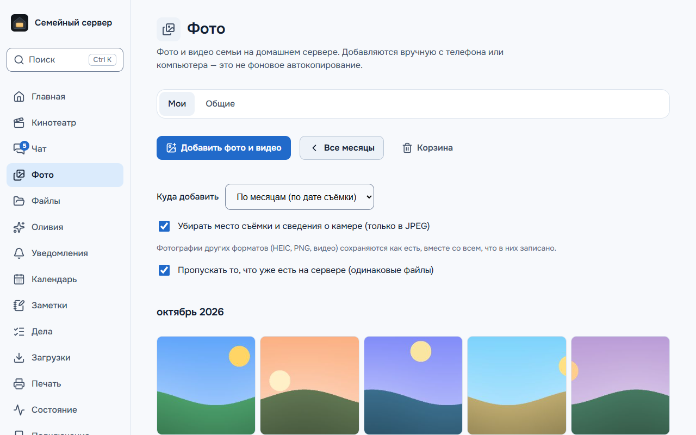

Что умеет добавление:

- **Обрыв связи не страшен.** Большой файл уходит кусками; если пропал интернет, очередь ждёт и продолжает с того места, где остановилась (после перезагрузки страницы то, что уже ушло, сохраняется на сутки).
- **Одинаковые фото пропускаются.** Портал сравнивает отпечаток файла с тем, что уже на сервере, и пишет «пропущено N (уже есть на сервере)». Если всё же нужно, кнопка «Всё равно загрузить повторы». Поймать можно только **точные** копии; похожие снимки он не считает одинаковыми.
- **Убрать место съёмки.** Галочка «Убирать место съёмки и сведения о камере (только в JPEG)» по умолчанию включена: перед сохранением из снимка вырезаются координаты и данные о камере (поворот снимка сохраняется). Фото других форматов (HEIC, PNG, видео) сохраняются как есть, вместе со всем, что в них записано.
- **Альбомы.** «Куда добавить» — «По месяцам» или в альбом; «Новый альбом» собирает снимки по поводу или человеку независимо от даты. Альбом можно переименовать. Альбомы лежат папками в «Альбомы», поэтому копии и поиск их тоже видят.
- **Корзина.** В просмотрщике есть «В корзину»; кнопка «Корзина» на странице возвращает снимок на место. Портал ничего не стирает навсегда.

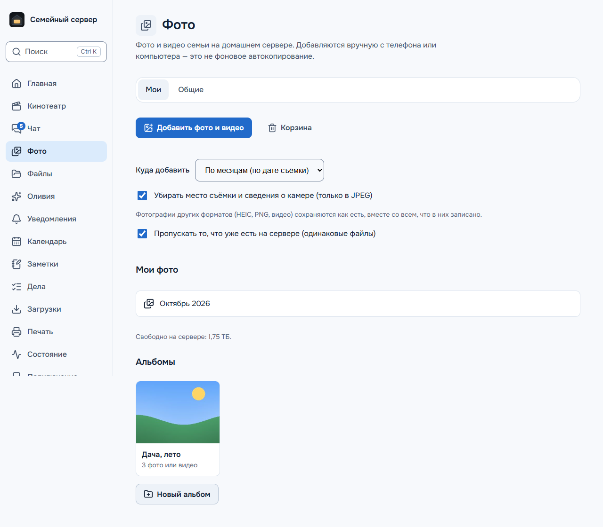

## 6. Файлы и корзина

«Личное» видите только вы (даже администратор через портал не видит), «Общее» — вся семья. Можно загружать **несколько файлов сразу** (очередь с докачкой, как у фото), открывать, скачивать, переименовывать, создавать папки. Программы (.exe, .bat и т. п.) не принимаются — это защита. Файл с тем же именем **не заменяет** прежний: рядом сохраняется копия с номером, так что старая версия не теряется.

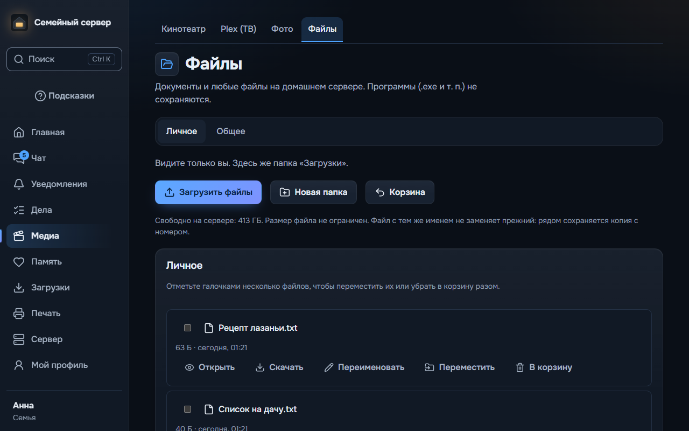

- **Открыть** показывает картинки, видео, звук, текстовые файлы и PDF прямо на странице (PDF — кнопкой «Открыть в новой вкладке»: его показывает сам браузер). Остальное — «Скачать». Файлы показываются с запретом на запуск программ внутри, поэтому чужой файл не может ничего сделать с порталом.
- **Выбор галочками.** Отметьте несколько файлов — появится панель «Переместить…», «В корзину», «Снять выбор». Перед перемещением в корзину портал называет, что именно уйдёт.
- **Переместить.** Окно с папками этого раздела: откройте нужную и нажмите «Переместить сюда».

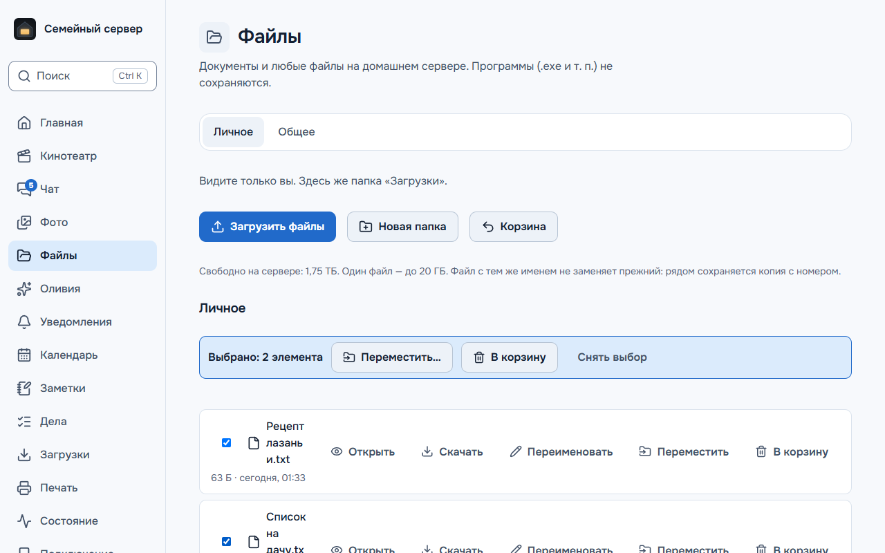

- **Корзина.** «В корзину» ничего не стирает навсегда: удалённое лежит в «Корзине» — кнопка вверху страницы. Рядом с каждым пунктом есть «Вернуть» (на прежнее место; если имя занято, вернётся под другим). Очистить корзину насовсем может только администратор на самом сервере. Содержимое корзины в ночные копии **не входит**: пока файл в корзине, копии у него нет.

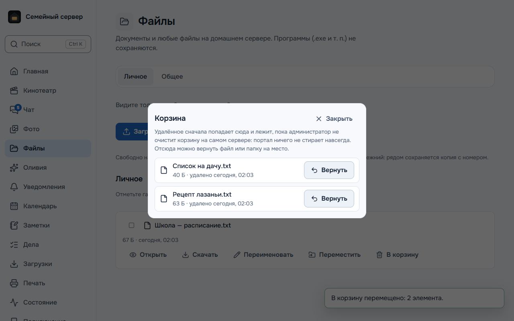

- **Место.** В личном разделе есть строка «Занято … из …»: с 90 % она предупреждает, а на 100 % новые файлы не принимаются, пока вы не уберёте лишнее в корзину или администратор не увеличит место. Если администратор не задал ограничение, строки нет.

Копии: сервер каждую ночь копирует файлы и фото на запасный носитель. Зашифрованной копии вне дома пока нет ([раздел 13](#13-что-пока-не-работает-или-не-проверено)).

## 7. Дела и списки покупок

«Дела» — общий и личный список: что сделать, когда и кому. Дела разложены по срокам: «Просрочено», «Сегодня», «Завтра», «Позже», «Без срока» и «Сделано» (с отметкой, кто сделал). Новое дело добавляется одной строкой; у дела можно задать срок и время, повтор («каждую неделю» и т. п.), поручить его другому человеку и выбрать список. Есть отдельный вид **«Список покупок»**: по одному пункту на строке, вставить можно целиком.

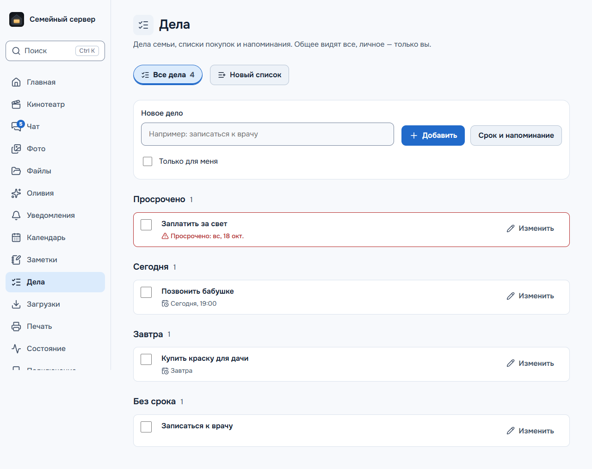

- **Список личный** — видите только вы; **общий** — вся семья.
- **Напоминание** приходит уведомлением в портале в срок (если время не задано — утром, около 9:00). Включить или выключить его можно на странице «Уведомления». Сообщение на телефон приходит, только если там включён push ([раздел 13](#13-что-пока-не-работает-или-не-проверено)).
- Сегодняшние дела видны и на главной странице.

### Сроки и гарантии

Раздел «Сроки и гарантии» хранит даты окончания: страховка, паспорт, гарантия на технику, подписки. Впишите название и дату, отметьте, за сколько дней напомнить, — портал пришлёт уведомление в нужный день. «Личные» сроки видите только вы, «общие» — вся семья.

### Утренний дайджест

Раздел «Дайджест» — короткая личная сводка на утро: ваши дела и события дня, ближайшие сроки, что скачалось ночью, погода и курсы. Её пишет модель на домашнем компьютере (она видит только ваши данные); если модель не справилась, сводка собирается по шаблону. «Сделать сейчас» делает её сразу, «Присылать мне» включает и выключает утреннюю рассылку. Если администратор подключил Telegram, сводка придёт и туда.

### Что с сервером

Страница «Что с сервером» отвечает на вопрос «почему не работает»: есть ли у домашнего компьютера интернет, работает ли кинотеатр, свежая ли резервная копия, хватает ли места. Подробности для администратора — на странице «Безопасность».

## 8. Чат и звонки

В «Чате» — разговоры один на один и группы («Вся семья» есть всегда; можно создать свою, например «Дача»). К сообщению можно прикрепить фото или файл (скрепка). Под своим сообщением видно «Доставлено» и «Прочитали».

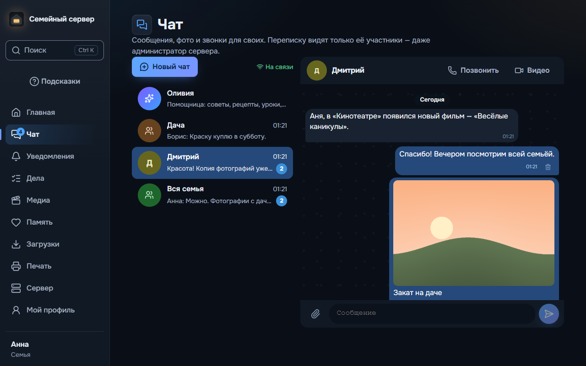

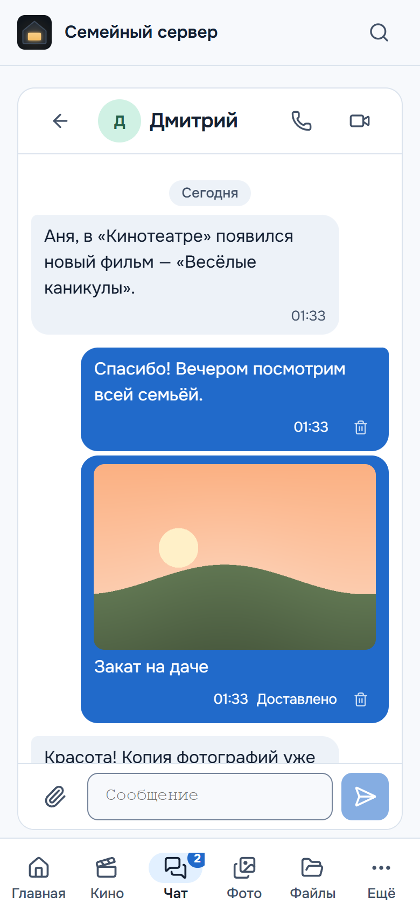

**Переписку видят только её участники — даже администратор сервера.** Файлы чата лежат на домашнем компьютере, как и всё остальное.

**Звонки.** В разговоре есть кнопки «Позвонить» (голос) и «Видео». Во время звонка можно выключить звук и камеру. В звонке — до 4 человек.

Входящий звонок выглядит так:

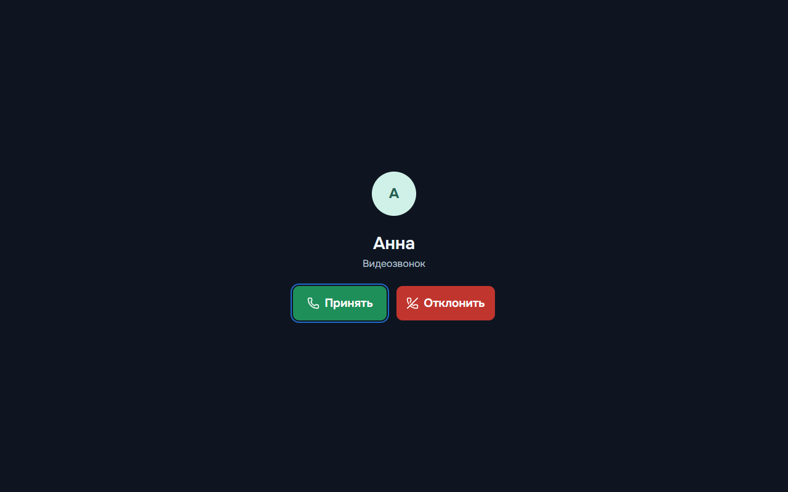

А так — идущий разговор (на снимке тестовая «камера»):

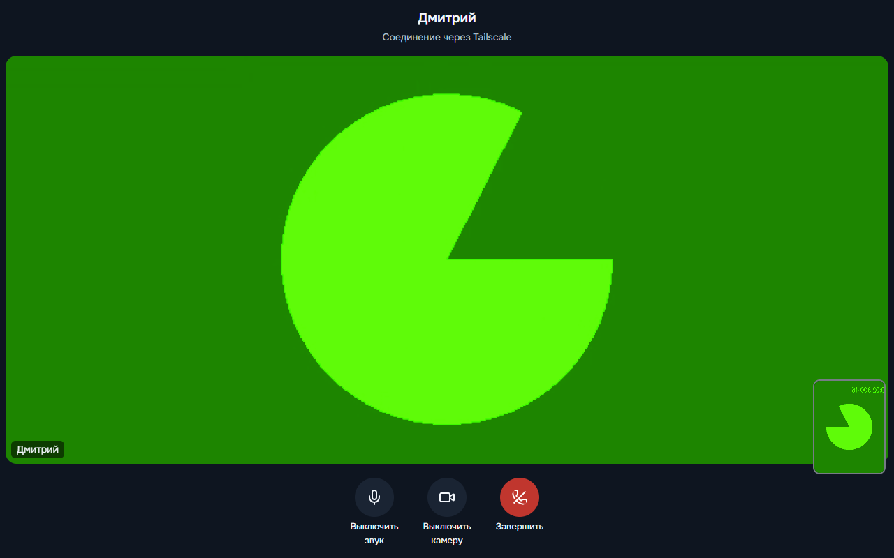

Что нужно знать о звонках честно:

- Камера и микрофон работают только при открытии портала по основному адресу (Tailscale) — браузеры не разрешают их на обычных `http://`-адресах.
- Если портал закрыт, звонок вы не услышите — придёт только уведомление (если включено). На iPhone входящий звонок виден, только когда портал открыт.
- Звонок между двумя устройствами **в разных сетях** проверен пока только на одном компьютере двумя окнами; администратору нужно проверить его на настоящих устройствах ([runbooks/chat-and-calls.md](runbooks/chat-and-calls.md)). Через мобильную сеть без Tailscale он может не соединиться.

**Уведомления.** Раздел «Уведомления» показывает, что случилось, пока вас не было, и позволяет выбрать, о чём сообщать (сообщения, звонки, завершённые загрузки, проблемы сервера). Кнопка «Включить уведомления» включает их на этом устройстве.

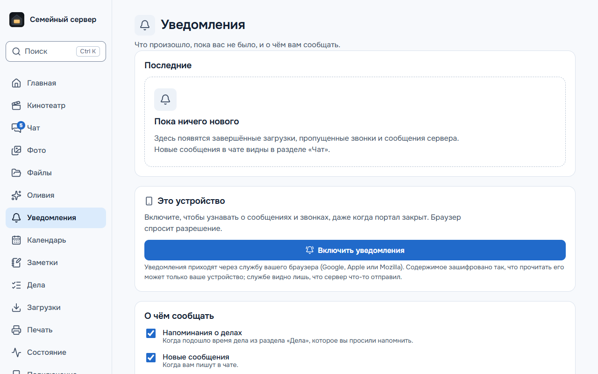

На iPhone уведомления работают только если портал добавлен «На экран „Домой“» (iOS 16.4 и новее). Одинаково на всех устройствах они не работают — это ограничения самих телефонов.

## 9. Оливия

Оливия — помощница сервера. Спросите её простыми словами: «найди фильм про каникулы», «сколько места на диске», «что с моими загрузками», «что у нас сегодня в календаре», «как установить портал на телефон».

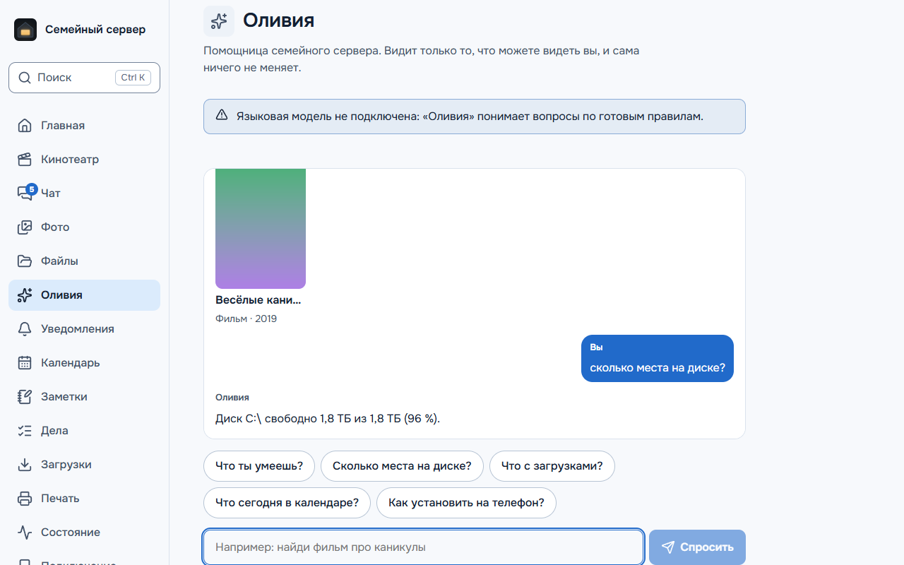

- Она видит только то, что можете видеть вы.
- Сама ничего не удаляет и не скачивает: для ссылки она лишь проверяет её и показывает кнопку «Скачать» — решаете вы.
- Работает только на домашнем компьютере: ни в какие облачные ИИ не обращается.
- Над строкой вопроса написано, подключена ли языковая модель. На снимке (тестовый сервер без модели) сказано «Языковая модель не подключена»: Оливия понимает **готовые формулировки**. На настоящем сервере модель установлена и понимает вопросы свободнее; если она ошибётся или не ответит, Оливия отвечает по правилам — это нормально.

## 10. Загрузки

Раздел для тех, у кого есть право «Загрузки» (его выдаёт администратор). Можно скачать файл по ссылке, по магнитной ссылке или из файла `.torrent` — **только то, что вам разрешено законом и правообладателем**. Программы и скрипты не сохраняются.

Перед стартом портал показывает, что внутри и сколько места нужно, и спрашивает, куда сохранить: в свои файлы или в общую медиатеку (фильмы, сериалы, мультфильмы, музыка):

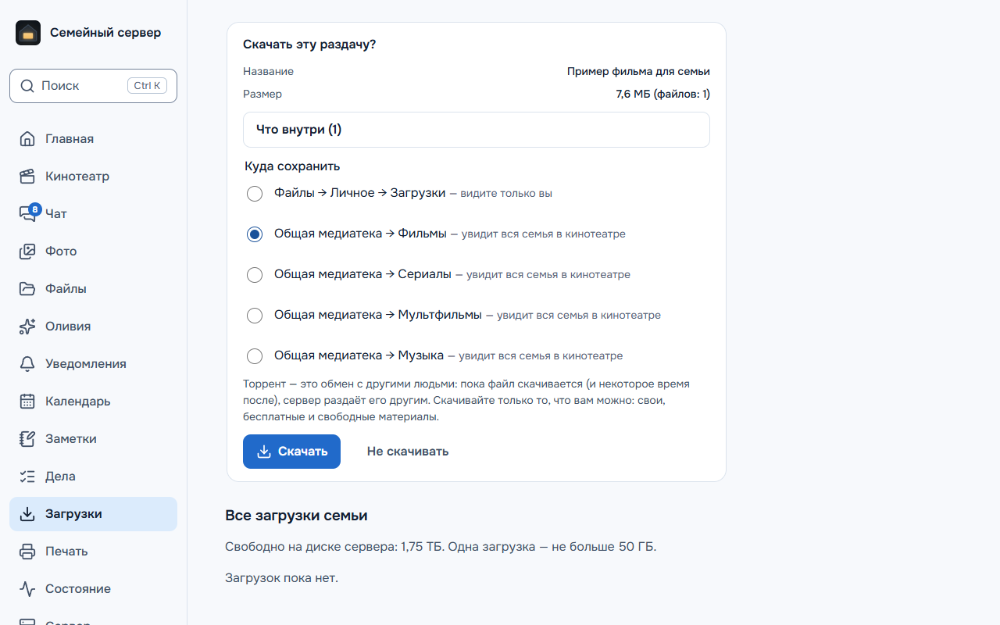

Очередь показывает прогресс, скорость, оставшееся время и ошибки; есть «Пауза» и «Отменить». Когда готово, фильм из медиатеки открывается кнопкой «Открыть в кинотеатре».

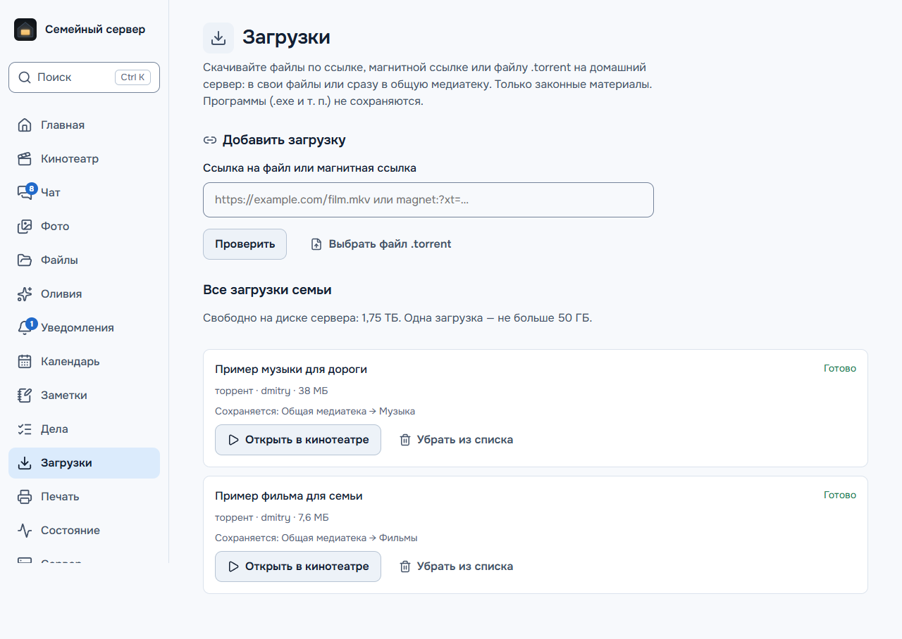

Торрент — это обмен с другими: пока файл скачивается (и недолго после), сервер отдаёт его другим. Отдача ограничена, чтобы не забить домашний интернет. Торрент-клиент установлен и проверен на одной законной раздаче ([раздел 13](#13-что-пока-не-работает-или-не-проверено)); на снимке очередь показана на проверочном макете клиента.

## 11. Состояние сервера и администрирование (для администратора)

**«Состояние»** — как себя чувствует домашний компьютер: процессор по ядрам, память, видеокарта, сеть, диски (что они сообщают о себе), удалённый доступ, принтер, резервные копии, программы сервера и график за сутки. Что не измерено, так и написано — «Недоступно», а не ноль. Серьёзные неполадки приходят уведомлением администратору.

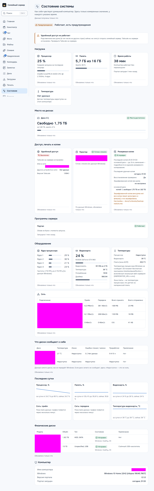

Чего здесь нет честно: температуры процессора. Windows её не сообщает; нужна бесплатная программа LibreHardwareMonitor (шаги — пункт 22 в [owner-actions.md](owner-actions.md)). «Температура платы» — это не процессор.

**«Администрирование»** — люди и журнал:

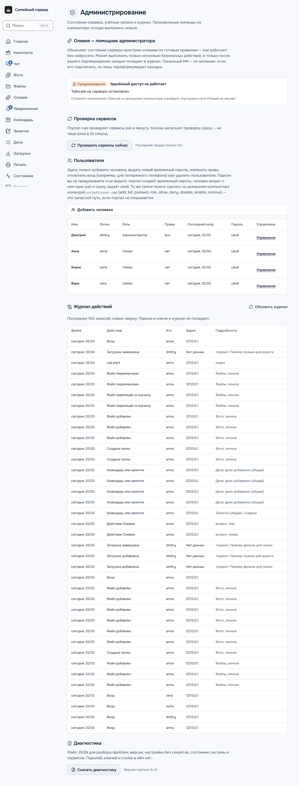

- **Добавить человека**: логин, имя, права. Портал создаёт временный пароль и показывает его **один раз**; передайте лично.
- **Управление**: новый временный пароль, права на загрузки и печать, роль администратора, **отключить вход** (потерянный телефон, ушедший гость) и вернуть, **закрыть вход на устройстве**, удалить человека. Личные файлы удалённого человека не стираются, а убираются в отдельную папку, чтобы их мог вернуть администратор на сервере.
- Администратор **не видит** чужие пароли и чужие личные чаты.
- **Журнал действий** показывает, кто и когда входил и что делал; паролей и ключей в нём нет.
- Через внешний HTTPS-адрес (если администратор его включит, [runbooks/public-https.md](runbooks/public-https.md)) администрирование недоступно вообще: только через Tailscale.

## 12. Если что-то не работает

| Что случилось | Что делать |
|---|---|
| Портал не открывается | Включён ли Tailscale? Включён ли домашний компьютер, есть ли дома интернет? Откройте на телефоне Tailscale и проверьте, что вход выполнен. Скажите администратору |
| «Нет связи с домашним сервером» | Сервер не отвечает. Подождите минуту, обновите страницу. Если не проходит — администратору |
| Фильм не играет | Попробуйте «Открыть в Jellyfin» или «Запасной просмотр» внизу «Кинотеатра». Большие файлы MKV/HEVC иногда не играют в браузере |
| Звонок не соединяется | Включите Tailscale на обоих устройствах; разрешите камеру и микрофон; откройте портал по основному адресу |
| Нет уведомлений на iPhone | Добавьте портал «На экран „Домой“», откройте его оттуда, на странице «Уведомления» нажмите «Включить» |
| Забыли пароль | Скажите администратору: он выдаст новый временный пароль |
| Потерян телефон | «Мой профиль» → «Мои устройства» → «Выйти» на потерянном; администратору — отключить вход, если нужно |
| «Это действие недоступно через внешний адрес» | Откройте портал через Tailscale |

## 13. Что пока не работает или не проверено

Здесь честный список. Пока написано «не готово» — полагаться на это нельзя.

| Возможность | Статус |
|---|---|
| Основной портал, кино и подборки, фото и файлы с очередью и корзиной, дела, общий поиск, чат, уведомления в портале, Оливия, Состояние, Администрирование | работает, проверено автоматически в Chrome и тестами; **загрузка фото с настоящего телефона пачкой и при обрыве связи на телефоне не проверялась** — ручные проверки: [owner-actions.md](owner-actions.md) |
| Торренты | работает: клиент установлен, одна законная раздача (образ Debian, 0,8 ГБ) скачана через портал и совпала по контрольной сумме; **пауза и продолжение на настоящей раздаче и обновление Jellyfin по завершении не подтверждены** |
| Языковая модель Оливии | работает на этом компьютере: в среднем 1,7 с на выбор инструмента, около 1,1 ГБ памяти при работе; при ошибке или недоступности Оливия отвечает по готовым правилам |
| Звонки между разными сетями | проверено на двух окнах одного ПК; **на двух настоящих устройствах — нет**; TURN не настроен |
| Уведомления на телефоне (push) | шифрование проверено по тестовому образцу; **на настоящем телефоне не проверено** |
| Дополнительный адрес через интернет (туннель) | **не создан**: нужны аккаунт и домен администратора; политика безопасности готова, пример настройки написан, но на этом компьютере не запускался |
| Температура процессора | нужна дополнительная программа |
| Копия вне дома | зашифрованная копия **умеет** создаваться и восстанавливаться (проверено на одноразовом ключе), но **не настроена**: нужны внешний диск и ключ администратора; пока копии лежат на сервере и на флешке |
| Приложения из App Store и Google Play | не планируются: портал ставится на экран как приложение (PWA) |

## 14. Как обновить картинки в руководстве

Для администратора. Картинки лежат в `docs/images/family-guide/` и снимаются автоматически на тестовом сервере с выдуманными данными.

```bash
npm.cmd run build
npm.cmd run guide:screenshots
```

Сценарий — `tests/guide/screenshots.spec.ts`: он сам поднимает тестовый сервер, создаёт четырёх выдуманных людей, сообщения, фото и фильмы, делает снимки и всё удаляет. Экран «Состояние» снимается с настоящими показаниями этого компьютера (имя компьютера закрашивается). Настоящая переписка, пароли и ключи в снимки не попадают. После съёмки откройте несколько картинок глазами и убедитесь, что на них нет ничего личного; тест `server/test/guide-docs.test.ts` проверяет, что все картинки из руководства существуют и это настоящие PNG.
